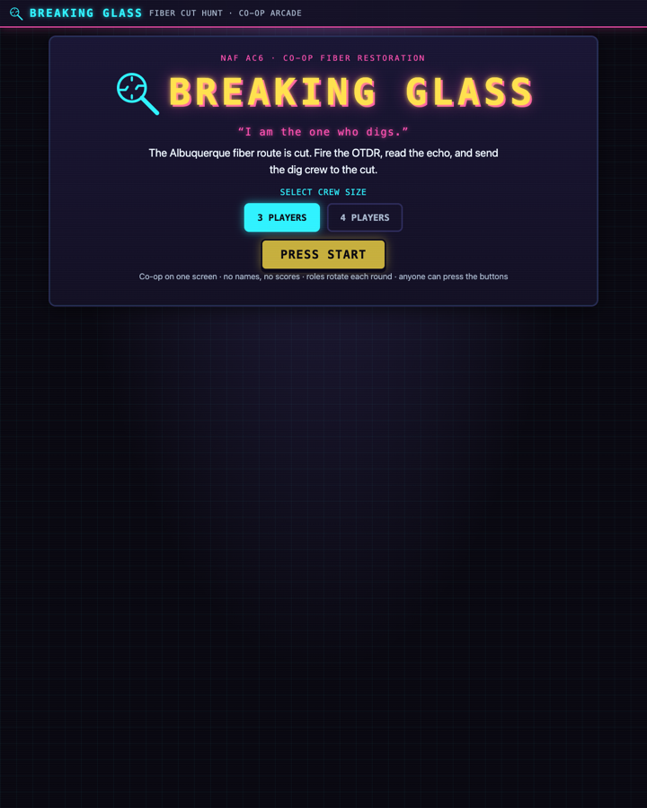
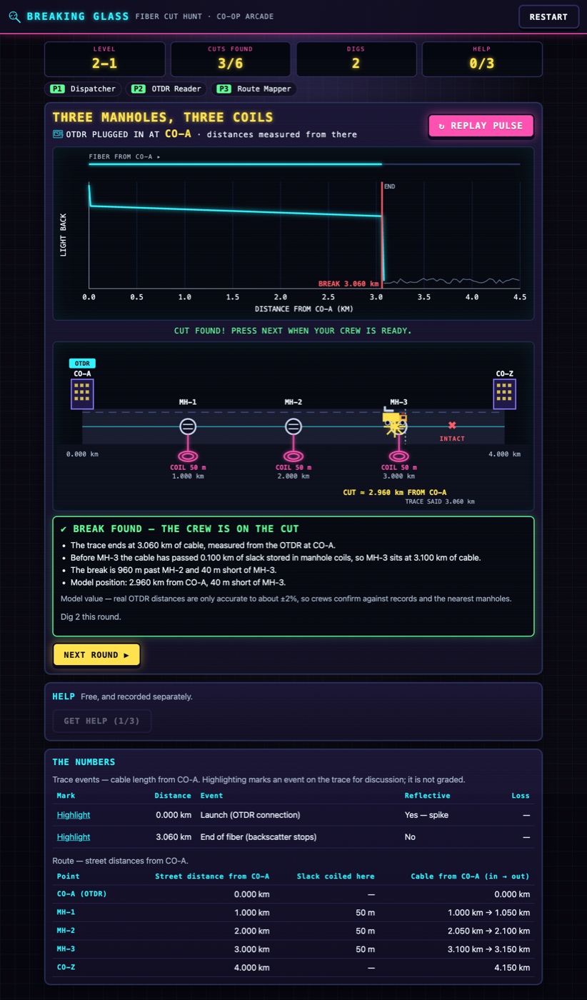

# Breaking Glass

**Read the trace, mind the slack, dig in the right place.**

Breaking Glass is a co-op **arcade-style** browser game for general networking students and new field technicians. A team of 3–4 plays as a fiber restoration crew around one shared screen. The team reads an OTDR trace to find where the Albuquerque fiber route is cut, then dispatches the dig crew to the right span or manhole. Every dispatch explains what the crew found, so the team can use it on the next cut.

A project from **NAF AC6 — Loop Engineering, Spec-Driven Development & the Future of VibeOps**.

| Project | Details |
| --- | --- |
| Status | **Playable, not verified.** All 6 rounds are implemented and the automated and browser checks pass. The required teammate re-check of the answers and the observed team playtest have not been run yet (see [Verification](#verification)) |
| Networking topic | Fiber fault location: reading an OTDR trace, cable distance vs street distance, manhole slack coils, testing from either end |
| Typical session | Target 10–15 minutes for a team of 3–4 (not yet measured with a real team) |
| Live demo | Not published yet |
| Built by | *Team names / GitHub handles to be added by the team* |





## The challenge

Press **⚡ FIRE OTDR**. A pulse of light races along the fiber, the trace draws itself behind it, and the echo bounces back from **3.060 km**. The street below puts MH-3 at **3.000 km**, so the crew might want to dig past MH-3. Click there and the truck drives out, digs, and finds **intact cable**, because MH-1 and MH-2 each store **50 m of slack coil**. The cable doesn't reach MH-3 until 3.100 km. Click the stretch of street between MH-2 and MH-3 and the truck drives onto the cut: **CUT FOUND!** The street then shows the cut at 2.960 km next to a dashed "TRACE SAID 3.060 km" line, so the slack offset is visible.

## What you'll learn

| By the end, you can… | You'll practice by… |
| --- | --- |
| Identify a fiber break on an OTDR trace and tell it apart from connectors and splices | Dispatching to where the backscatter ends, not to the biggest spike (Level 1) |
| Convert OTDR cable distance to a street position by adding the slack coiled in manholes | Choosing the span that contains the break once slack is counted (Level 2) |
| Handle a break inside a slack coil, and a trace shot from the far end | Dispatching to a manhole instead of a span, and measuring from the correct office (Level 3) |

**Before playing:** no prior knowledge needed; each level's briefing teaches what you need, with a worked example.

## Play locally

Download this repository or clone it using the URL from GitHub's **Code** button, then open a terminal in the project root.

```sh
python3 -m http.server 8000 --bind 127.0.0.1
```

On Windows with the Python launcher:

```powershell
py -m http.server 8000 --bind 127.0.0.1
```

Open **http://127.0.0.1:8000** in your browser. Keep the terminal running; **Ctrl+C** stops the server. If port 8000 is busy, use 8001 in both the command and the URL.

The game loads JavaScript modules and JSON over HTTP, so opening `index.html` directly from disk will not work. [Why modules need serving](https://developer.mozilla.org/en-US/docs/Web/JavaScript/Guide/Modules). There is nothing to install: no packages, build step, account, or API key.

## How to play

1. Pick **3 or 4 players** and press **PRESS START**.
2. Each level opens with a short briefing: two or three sentences and an animated demo (**↻ REPLAY DEMO** to watch again). **More detail** holds the full explanation, the worked example, the simplifications and the sources. Press **PRESS START** to begin.
3. In each round, press **⚡ FIRE OTDR**. The pulse runs out, the trace draws itself, and the echo returns from the break. The pulse stays on the trace and never points at the street.
4. Talk it over using the role cards (OTDR Reader, Route Mapper, Dispatcher, plus Safety Lead with 4 players). They rotate every round; anyone can press the buttons.
5. **Click the street** where the crew should dig: a stretch of road or a manhole. The truck drives there and digs. A miss leaves an **✖ INTACT** mark; a hit shows **CUT FOUND!** and enables **NEXT**.
6. Find all **6 cuts** (3 levels × 2 rounds) to reach **ROUTE RESTORED!**

| Control | Action |
| --- | --- |
| **⚡ FIRE OTDR** / **↻ REPLAY PULSE** | Shoot the OTDR (needed before digging); press again to replay the animation |
| Click a stretch of street or a manhole, or Tab to it and press Enter or Space | Dig there. That single action selects and submits |
| **GET HELP (1/3)** | Reveals, in order: the method, a worked step, then the full solution. Recorded as help used; never solves the round |
| **Highlight** in *The numbers* | Marks a trace event for discussion (not graded) |
| **NEXT ROUND ▶ / NEXT LEVEL ▶ / FINAL SCREEN ▶** | Enabled only after the cut is found |
| **RESTART** (top right) | Asks first. **Cancel** (or Esc) keeps everything; **Restart** returns to the title screen with counts cleared |

**HUD:** level, cuts found, digs this round, and help used. There are no points, lives, timers or rankings (constitution III).

**Progress:** a round completes only when the crew digs at the cut. Every dig at a valid spot counts once; firing the OTDR, help and highlighting count as nothing, and digging is locked once the cut is found. A level recap appears after each level's second round; the final screen shows found, digs and help per round and per level. **Reloading the page starts over**; nothing is stored.

## What this game models

A single-mode fiber route tested with an OTDR from one central office (the *test end*). Trace distances are **cable length** from the instrument; the OTDR result is assumed already corrected from fiber length to cable length. The break is the event where backscatter ends and the trace falls to the noise floor; it may or may not show a reflection. Walking the route from the test end, each manhole is reached at `street distance + slack stored in earlier manholes`, and its own coil adds its slack before the cable leaves. The break is in the span between two points if it falls between leaving one and reaching the next, or inside a manhole if it falls within that manhole's coil.

**Assumptions:** exactly one break per round; slack is stored only in manholes; distances are authored to the metre and treated as exact. A break closer than 25 m to a span or coil boundary is an authoring error. The game checks all content when it loads and refuses to start if any round is invalid.

**Simplifications the game states openly:** real OTDR distances are only accurate to about **±2%** (FOA), which is larger than some gaps in these rounds. In the field, crews confirm against records and the nearest manholes. The slack arithmetic is a **model** built from sourced facts (an OTDR measures fiber length, and extra cable is stored in service loops). No source we read states it as a rule, and the briefings say so.

**Outside the model:** IOR and helix calibration errors, dead zones, ghosts, gainers, bidirectional averaging, macrobends and partial damage, loss budgets, multiple faults, and GIS/GPS mapping.

| Reference | What it supports |
| --- | --- |
| [FOA Reference – OTDRs](https://www.thefoa.org/tech/ref/testing/OTDR/OTDR.html), *How Does an OTDR Work?*, *Information in the OTDR Trace*, *Index of Refraction* | An OTDR sends pulses and displays backscatter along the fiber; connectors and mechanical splices show reflective peaks; fusion-splice loss can be very small; IOR calibrates distance |
| [FOA Reference – OTDR FAQs](https://www.thefoa.org/tech/ref/testing/OTDR/OTDR-FAQS.html), *Systematic Errors*; *…Big Reflections From The End Of The Cable But Sometimes … None At All*; *…Troubleshooting A Break In A Long Cable Run…* | An OTDR measures fiber length, not cable length; a ragged break shows little reflection while a clean cleave shows a large one; correct a break distance with records of the cable plant |
| [FOA – Fiber Optic Network Restoration](https://www.thefoa.org/tech/ref/restoration/rest.html), *Locating Faults*; *Designing For Non-Stop Operation As Well As Restoration*; *Test Equipment*; *Mapping The Route* | "On long cables, an OTDR must be used to locate the problem"; "OTDR data is not accurate: ~ +/-2%…"; "Look for the end, compare to the expected length…"; store extra cable in service loops; route maps are needed |

These quotes were checked word for word on 2026-11-17. ITU-T G.650.1 was considered but dropped, because its backscatter clause couldn't be confirmed without the full text.

## How it was built

The project follows the workshop's Spec Kit workflow: **constitution → specify → clarify → plan → tasks → analyze → implement**. The verification section below records which behaviors have actually been checked.

- **Stack:** semantic HTML5, CSS, and native JavaScript ES modules; inline SVG for the trace and the street, each with a text table; arcade effects with the browser's Web Animations API. No framework, bundler, game engine, or runtime dependency.
- **Build tools:** Claude Code (Claude Opus 5.5); GitHub Spec Kit 1.4.2.dev0 with the Claude integration. Browser checks were run with headless Google Chrome through a throwaway script that isn't part of the repository.
- **Runtime:** static files in a modern browser; no model, account, backend, network service, or API key. `package.json` has no dependencies; it only marks `.js` files as ES modules for the Node test runner.
- **Planning inputs:** `StarterKit/CONSTITUTION.md`, `StarterKit/SPEC.md`, `StarterKit/PLAN.md`.
- **Working artifacts:** [.specify/memory/constitution.md](.specify/memory/constitution.md) (v1.0.2), [specs/001-breaking-glass-otdr/](specs/001-breaking-glass-otdr/), which holds `spec.md`, `plan.md`, `research.md`, `data-model.md`, `contracts/`, `quickstart.md`, and `tasks.md`.
- **Code layout:**
  - `engine/` holds the pure rules, content validation, session state, and feedback text.
  - `ui/` holds the rendering and arcade animations (`ui/anim.js`).
  - `data/levels.json` holds all rounds, hints, and sources.
  - `tests/` holds the test suites.
- **One useful design decision:** for the arcade redesign, the light-pulse animation was kept on the *trace*, not the street. If the pulse had visibly stopped at the cut on the street map, it would have given away the answer and skipped the slack lesson. A real OTDR doesn't know where the street is either.
- **Another:** checking the sources during planning showed that OTDR distance is only about ±2% accurate. That made the spec's original claim false: it had said the 25 m authoring margin covered measurement uncertainty. We kept exact distances, so each round still has one teachable answer, and the briefings and every correct-answer message now state the limit openly. Analysis also made the source review, an independent answer re-check, and a team playtest required before this game can be called verified.

## Verification

**Last checked:** 2026-11-17 · macOS (Darwin 27.2) · Node 22.14 · headless Google Chrome 157.0.8103.79 · uncommitted working tree (no commit yet). Re-checked after the arcade redesign.

Automated tests: `node tests/run.mjs` (or `npm test`) from the repository root, or open **http://127.0.0.1:8000/tests/** while the server is running. Both report totals and failed case IDs, and treat zero discovered tests as a failure.

| Check | Result | Evidence / notes |
| --- | --- | --- |
| Correct, incorrect, and boundary cases | **Pass** | `node tests/run.mjs`: **95 passed, 0 failed**; the same 95 pass in the browser runner. Covers all 6 rounds' answers and every listed misconception, evidence numbers, 13 invalid-content fixtures including the 3.090 km case, a check that shipped data matches the spec, briefing demos, a trial 7th round, and the fire-then-dig rules |
| Teammate independently re-checks the six-round answer table (T043) | **Not run** | Required before "verified" |
| Briefings and explanations checked against sources (T042) | **Pass** | FOA restoration quotes confirmed word for word; G.650.1 dropped; briefings (including the new short summaries) and explanation templates reviewed. Open gap: no direct source for the slack-loop offset (presented as a model) |
| Real-mouse play of all 6 rounds | **Pass** | Scripted browser run with real mouse clicks on the street zones: misses and hits in every round, each listed misconception's message, miss markers, CUT FOUND, zones locked after solving, level recap, final screen |
| Fire OTDR rules | **Pass** | Digging before firing is ignored (DIGS stays 0); the pulse is drawn on the trace only; dig zones are usable immediately during the animation; the trace table appears after firing |
| Help, restart, reload | **Pass** | 3 help steps in order; Restart → Cancel keeps the final screen; Restart → confirm returns to the title; reload mid-round returns to the title |
| Content error at load | **Pass** | L2R1's break changed to 3.090 km in the served response only: "Content problem" naming `ambiguous-break`; the game doesn't start |
| Roles rotate (3 and 4 players) | **Pass** | L1R1: P1 OTDR Reader, P2 Route Mapper, P3 Dispatcher; L1R2 shifted by one; 4 players shows Safety Lead |
| Keyboard-only core playthrough | **Pass (scripted)** | Level 1 with Tab and Enter only: Fire OTDR, Tab to the street zone, Enter to dig, Next. Dashed focus ring visible. Not yet repeated by a person or with a screen reader |
| Narrow layout and reduced motion | **Pass** | 360 px: no page-level sideways scroll; charts scroll inside their own area; HUD in 2 columns. Reduced motion: trace appears at once, no truck or banner animation, result and feedback immediate |
| Feedback never waits for animation | **Pass** | Feedback text is present right after the click, before the truck arrives |
| Projector readability at ~3 m (SC-007) | **Not run** | |
| Performance | **Pass** | Title screen visible about 155 ms after navigating |
| Observed team playtest: time ≤ 15 min, ≥ 4 of 5 players explain their mistake (T044) | **Not run** | Required before "verified". Also the real test of "fun to play" |
| Fresh checkout run instructions | **Pass (copy, before the redesign)** | Repeat with a real `git clone` after the first push |
| Other browsers (Firefox, Safari, Edge) | **Not run** | The animations use the Web Animations API, which current versions support |
| No console errors | **Pass** | None during the full scripted run |

## Known limitations and next steps

- **Known limitation:** the event table names the last event "End of fiber". Level 1's trace-reading step is therefore easier from the table than from the chart. The spec requires every event's type in text, so this is a real trade-off.
- **Known limitation:** measurement uncertainty is disclosed but not modelled, so a real crew would treat a break 30–40 m from a manhole as "check both sides".
- **Known limitation:** no direct source yet for the slack-loop distance offset; the briefings present it as a model.
- **Next improvement:** accept a small range of sites when a break is within the OTDR's uncertainty of a boundary, and teach "check the neighbouring manhole". That would turn the ±2% caveat into a decision.

Found an incorrect answer or unclear explanation? Open an issue with the level/round, input values, your choice, expected result, actual result, and a reference if available.

## Credits

Created by *the team (names to be added)*. Workshop by John Capobianco, Joksan Flores, and Elliot Conner. Adapted from the [NAF AC6 workshop materials](https://github.com/automateyournetwork/NAF_AC6) and [Networking Video Game Starter Kit](https://github.com/automateyournetwork/NetworkingVideoGameStarterKit), using [GitHub Spec Kit](https://github.com/github/spec-kit).

The "Albuquerque route" is a fictional fiber route; it does not depict any real network or person.

**Assets and dependencies:** original SVG icons made for this project (`assets/icons/`); no photographs, fonts, or third-party assets.

**License:** Apache 2.0, inherited from the workshop materials; see [LICENSE](LICENSE).
